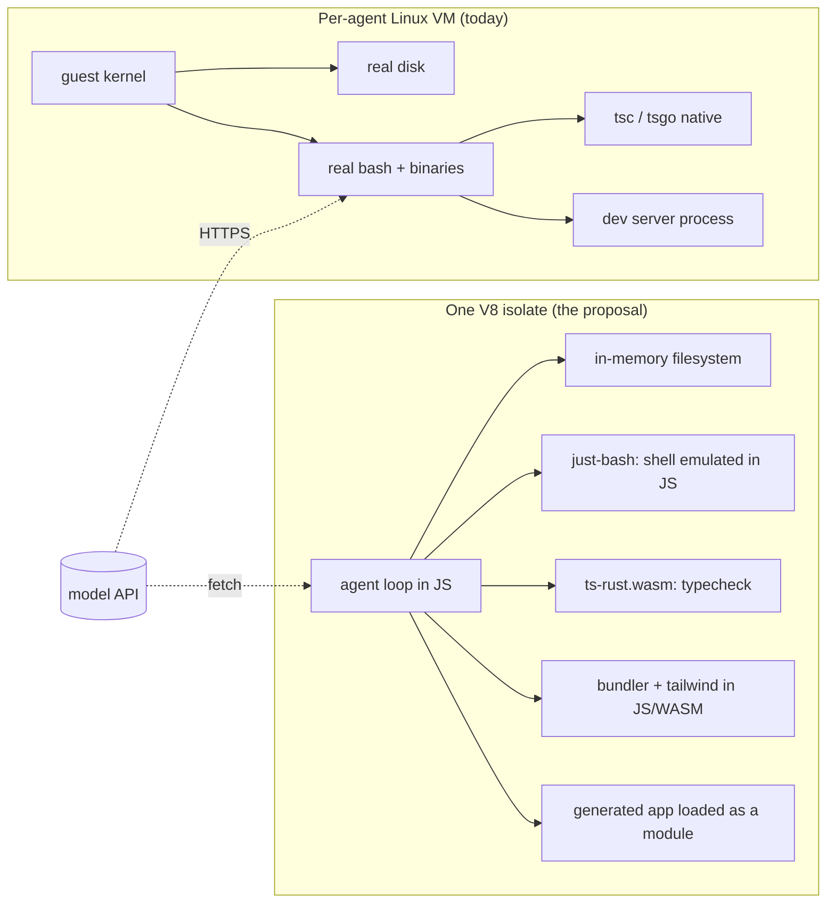

# V8 isolates as agent compute, explained from first principles

**One line:** an isolate is one sandboxed JavaScript heap inside an ordinary user-space process; it has no OS, files or binaries of its own, so "agent in an isolate" means faking the filesystem and shell in JS and shipping every native tool as WASM. Cheap and fast, but narrower and less proven than the video implies.

Labels: **SAID** = Theo says it. **SHOWN** = on screen (taken from the shared brief; I did not re-inspect frames). **VERIFIED** = confirmed from a primary source, URL given. **INFERRED** = my reasoning. **FROM MEMORY** = not checked against a source in this pass.

Research status: web fetch and search worked. Checked 2026-11-25. Items I could not confirm are listed in section 8.

---

## 0. The idea in 60 seconds

- Today a cloud coding agent gets a Linux VM: real disk, real bash, real `tsc`, real dev server. Memory is reserved for the whole session even while the agent waits on the model.
- Theo's proposal [28:17-41:30] SAID: put the whole loop (files, shell, typecheck, bundle, run the app) inside one V8 isolate, the same primitive that Chrome, Node and Cloudflare Workers use.
- What makes it possible:
  - a fake bash + in-memory filesystem written in TypeScript (`just-bash`)
  - a TypeScript checker small enough to ship as WebAssembly (`ts-rust`, 4.2 MB)
  - a bundler and CSS step that also run in JS/WASM
- Why it could be cheap: an isolate costs a few MB and a few ms, and Workers bill CPU time, not wall-clock time.
- Biggest correction to the video: an isolate is **not** "in the kernel". It is a language-VM boundary in user space. See section 1.6.



---

## 1. What a V8 isolate is, precisely

### 1.1 Definition

| Term | Meaning | Source |
|---|---|---|
| Isolate | "a VM instance with its own heap". A fully separate instance of the V8 engine: own heap, own garbage collector, own state | VERIFIED https://v8.dev/docs/embed |
| Threading rule | Only one thread may be inside a given isolate at a time; several isolates can run in parallel on different threads; objects cannot be passed between isolates | VERIFIED https://v8.github.io/api/head/classv8_1_1Isolate.html |
| Context | A global scope (own `globalThis`, own built-in prototypes) **inside** an isolate. Many contexts can share one isolate and one heap | VERIFIED https://v8.dev/docs/embed |
| Embedder | The program that links V8 and decides what the JS can touch (Chrome, Node, Deno, workerd). An isolate can do nothing except compute until the embedder hands it APIs | INFERRED from the embedding model in https://v8.dev/docs/embed |

Key consequence (INFERRED): "what an isolate can do" is not a fixed list. Node's main isolate can read disk and spawn processes because Node gives it those bindings. A Cloudflare Worker isolate cannot because workerd withholds them.

### 1.2 Isolate vs context vs process vs thread

```
OS process (address space, syscalls, the thing the kernel knows about)
 └─ thread(s)
     └─ V8 isolate   (heap + GC; one thread inside at a time)   <- V8 concept, user space
         └─ context  (one global object / realm)                <- V8 concept
             └─ your JS, plus any WASM instances it creates
```

- The kernel has no idea isolates exist. It sees one process using memory. INFERRED from the definitions above.
- A WASM module does not get its own isolate. It is instantiated by JS inside an isolate and lives there. FROM MEMORY (standard WebAssembly JS API behaviour).

### 1.3 Where isolates appear in Chromium

| Thing | Isolate? | Notes | Source |
|---|---|---|---|
| Renderer main thread | One isolate | Blink: isolates and threads are 1:1 | VERIFIED https://chromium.googlesource.com/chromium/src/+/main/third_party/blink/renderer/bindings/core/v8/V8BindingDesign.md |
| Each frame / iframe in that renderer | A **context**, not an isolate | N frames x M worlds = N*M contexts in one isolate | VERIFIED same |
| Extension content scripts | An "isolated **world**" (extra contexts) in the page's isolate | Not a separate isolate | VERIFIED same |
| Web Worker / Service Worker / worklet thread | Own isolate, single context | One isolate per worker thread | VERIFIED same |
| Different sites | Different **OS processes**, each sandboxed | This is Site Isolation, the real security boundary between sites | VERIFIED https://www.chromium.org/Home/chromium-security/site-isolation/ |

- Chrome's threat model assumes a renderer **will** be compromised, so the defence is process + OS sandbox, with isolates inside. VERIFIED https://www.chromium.org/Home/chromium-security/site-isolation/
- Of Chrome exploits seen in the wild 2021-2023, all started with renderer memory corruption and 60% were V8 bugs. VERIFIED https://v8.dev/blog/sandbox
- So "tabs cannot read each other because of V8 isolates" [29:06] SAID is the wrong mechanism. INFERRED from the two sources above.

### 1.4 Where isolates appear in Node, Deno

| Runtime | Construct | Isolate? | Source |
|---|---|---|---|
| Node | Main program | One `node::Environment` = exactly one `v8::Isolate` + one libuv event loop | VERIFIED https://nodejs.org/api/embedding.html |
| Node | `worker_threads` Worker | "independent JavaScript execution thread"; own JS engine limits via `resourceLimits`; can share memory only via `SharedArrayBuffer` / transfer | VERIFIED https://nodejs.org/api/worker_threads.html (the page does not use the word isolate; the one-isolate-per-Environment rule comes from the embedding doc) |
| Node | `node:vm` | Creates **contexts** in the current isolate. "not a security mechanism. Do not use it to run untrusted code." | VERIFIED https://nodejs.org/api/vm.html |
| Node | `isolated-vm` (npm) | Exposes real extra isolates with own heap and `memoryLimit`; maintenance mode; README still recommends a separate process for hostile code | VERIFIED https://github.com/laverdet/isolated-vm |
| Deno | Deno Deploy | Each deployment runs "in its own V8 isolate in its own process" (2022 description; current architecture not re-checked) | VERIFIED https://deno.com/blog/anatomy-isolate-cloud |

Relevance to the demo: the stats panel label "load into vm 1.4ms" SHOWN [33:23] suggests the generated app is loaded with `node:vm` or similar. INFERRED. If so, the generated code shares the host isolate's heap and gets no security boundary.

### 1.5 Where isolates appear in Cloudflare Workers

- Runtime is `workerd`. "A single instance of the runtime can run hundreds or thousands of isolates, seamlessly switching between them." VERIFIED https://developers.cloudflare.com/workers/reference/how-workers-works/
- Many tenants share one OS process. Free-plan and Enterprise customers are not placed in the same process. VERIFIED https://developers.cloudflare.com/workers/reference/security-model/
- No per-tenant kernel, container or VM. Only JavaScript and WebAssembly are accepted; no native binaries. VERIFIED https://blog.cloudflare.com/mitigating-spectre-and-other-security-threats-the-cloudflare-workers-security-model/
- Defence in depth around the isolate (all VERIFIED https://developers.cloudflare.com/workers/reference/security-model/):
  - layer-2 process sandbox: Linux namespaces + seccomp, no filesystem or network access for the process
  - Spectre: `Date.now()` frozen during execution, no other timers, no threads or shared memory
  - suspicious Workers are moved to their own process
  - V8 patch gap "under 24 hours"
- Cloudflare's own admission: V8 has a wider attack surface than a VM, and V8 bugs are more common than hypervisor bugs. VERIFIED https://blog.cloudflare.com/mitigating-spectre-and-other-security-threats-the-cloudflare-workers-security-model/ and https://blog.cloudflare.com/dynamic-workers

```
           one Linux host, one kernel
┌──────────────────────────────────────────────────────┐
│ workerd process  (namespaces + seccomp sandbox)      │
│  ┌───────────┐ ┌───────────┐ ┌───────────┐           │
│  │ isolate A │ │ isolate B │ │ isolate C │ ... x1000 │
│  │ tenant 1  │ │ tenant 2  │ │ tenant 3  │           │
│  │ heap+GC   │ │ heap+GC   │ │ heap+GC   │           │
│  └───────────┘ └───────────┘ └───────────┘           │
│   shared: V8 code, runtime, process, kernel          │
└──────────────────────────────────────────────────────┘
  vs. VM hosting: one guest kernel + userland per tenant
```

### 1.6 The distinction the video blurs

| Video wording | Reality |
|---|---|
| "that isolate is in the kernel" [29:06] SAID | Isolates are user-space data structures inside a normal process. Nothing about them lives in the kernel. VERIFIED https://v8.dev/docs/embed |
| "a worker is an isolated JS process inside of V8" [29:06] SAID | Not an OS process. Thousands of isolates share one process. VERIFIED https://developers.cloudflare.com/workers/reference/how-workers-works/ |
| Chrome tabs are separated by isolates [29:06] SAID | Sites are separated by OS processes + sandbox; isolates sit inside. VERIFIED https://www.chromium.org/Home/chromium-security/site-isolation/ |
| extensions / WASM are separate "isolate workers" [34:14] SAID | Content scripts are extra contexts ("worlds") in the page isolate; WASM runs inside the creating isolate; only worker threads get their own isolate. VERIFIED (first and third) https://chromium.googlesource.com/chromium/src/+/main/third_party/blink/renderer/bindings/core/v8/V8BindingDesign.md |

The accurate mental model: **isolate = language-level isolation, enforced by V8's correctness, in user space.** Container = kernel-enforced namespaces. VM = hardware-enforced via a hypervisor. Each step down is heavier and has a smaller, better-audited attack surface.

---

## 2. The isolation ladder

Order-of-magnitude figures. "Mem" = fixed overhead per instance before your workload.

| Level | Isolation mechanism | What is shared | Cold start | Mem overhead | What can run | Who uses it |
|---|---|---|---|---|---|---|
| Bare process | Kernel process boundary, users, permissions | Kernel, filesystem, network | ~ms | ~MB | Anything | Your laptop; agents run locally |
| Container | Namespaces + cgroups; "share the OS kernel ... isolated processes in user space" | Host kernel | "hundreds of milliseconds" | "hundreds of megabytes" for a typical workload (Cloudflare's framing) | Any binary for the host kernel's OS | Docker, Kubernetes |
| gVisor | User-space "application kernel" intercepts syscalls | Host kernel behind a narrow interface | sub-second (FROM MEMORY) | tens of MB (FROM MEMORY) | Most Linux binaries | Google Cloud Run |
| microVM (Firecracker) | KVM hardware virtualization, minimal device model, jailer | Hardware, host kernel as hypervisor only | "<125ms" boot | "<5 MiB overhead per VM" plus the guest OS and RAM you provision | Any Linux binary, own kernel | AWS Lambda, AWS Fargate, Vercel Sandbox, Cloudflare Containers / container-backed Sandbox (microVM per instance), E2B (FROM MEMORY), Fly Machines (FROM MEMORY) |
| Full VM | Hypervisor, full device model | Hardware | seconds to tens of seconds (FROM MEMORY) | Full OS, "tens of GBs" of image | Any OS | EC2, Hetzner Cloud, Cursor cloud agents ("isolated VMs", 16 GB default), Claude Code cloud sessions (Ubuntu VM, 4 vCPU / 16 GB / 30 GB) |
| V8 isolate | V8 heap sandboxing (software) + embedder process sandbox | Process, V8 code, kernel | ~5 ms; "a few milliseconds" | ~3 MB; "a few megabytes" | JS and WASM only | Cloudflare Workers, Dynamic Workers, Deno Deploy, Chrome, Node |
| WASM instance | Linear-memory sandbox, validated bytecode, only imported functions callable (FROM MEMORY) | The host isolate/process | µs-ms once compiled (FROM MEMORY) | Size of its linear memory | Anything compiled to WASM, within host imports | ts-rust-wasm, esbuild-wasm, Pyodide, sql.js; WebContainers builds a whole Node-like OS on it |

Sources for the numbers (all VERIFIED):
- Isolate 5 ms start, ~3 MB vs 35 MB for a Node Lambda: https://blog.cloudflare.com/cloud-computing-without-containers/ (2018, Cloudflare's own figures)
- Isolate "a few milliseconds ... a few megabytes"; containers "hundreds of milliseconds" and "hundreds of megabytes"; ~100x faster, 10-100x less memory: https://blog.cloudflare.com/dynamic-workers (2026-03-24, vendor claim)
- Firecracker <125 ms, <5 MiB, up to 150 microVMs/s/host, KVM, jailer: https://firecracker-microvm.github.io/
- Firecracker built for Lambda and Fargate: https://github.com/firecracker-microvm/firecracker
- Containers share the kernel, VMs carry a full OS: https://www.docker.com/resources/what-container/
- gVisor definition, Cloud Run: https://gvisor.dev/docs/
- Vercel Sandbox = Firecracker microVM with dedicated kernel: https://vercel.com/docs/sandbox/concepts
- Cloudflare container instance = "a microVM with its own kernel and network": https://developers.cloudflare.com/sandbox/
- Cursor "isolated VMs": https://cursor.com/docs/cloud-agent ; 16 GB default per Cursor staff: https://forum.cursor.com/t/cloud-agent-unclear-error-and-termination-of-sessions-when-using-too-much-ram/167322
- Claude Code cloud VM specs: https://code.claude.com/docs/en/cloud-environments
- Deno Deploy isolates: https://deno.com/blog/anatomy-isolate-cloud

Read the table this way (INFERRED): the Firecracker *overhead* (5 MiB) is not the problem. The cost of a VM is the **guest RAM you must reserve** (2-32 GB) for a kernel, userland, node_modules and tools, held for the whole session. An isolate shares all of that with its neighbours and only owns its heap.

---

## 3. What an isolate cannot do, and how each gap is filled

| Gap | Why | How it gets faked or filled | Caveat |
|---|---|---|---|
| Real filesystem | No syscalls exposed | In-memory FS (just-bash `InMemoryFs`); SQLite-backed FS in a Durable Object (`@cloudflare/computer`); Workers `node:fs` virtual FS | Workers `/tmp` is "not persistent and ... unique to each request", 128 MB per file, counts against memory. VERIFIED https://developers.cloudflare.com/workers/runtime-apis/nodejs/fs/ |
| Process spawn / shell | No `fork`/`exec` | Shell interpreter in JS: just-bash parses bash and runs built-in reimplementations of commands | Only commands someone rewrote exist. See 3.1 |
| Native binaries | No machine code allowed | Compile the tool to WASM: ts-rust (4.2 MB), esbuild-wasm, SWC/oxc/rolldown, SQLite, Pyodide | Slower, single-threaded, memory-capped. See 3.2 |
| Raw sockets / listening server | No `listen()` | Outbound `fetch()`; Workers `connect()` for outbound TCP; the "server" is just a fetch handler called in-process | No outbound port 25, no private IPs. VERIFIED https://developers.cloudflare.com/workers/runtime-apis/tcp-sockets/ |
| Persistence | Isolate can be evicted any time | Durable Objects (SQLite), KV, R2, D1 | Global state is not guaranteed across requests. VERIFIED https://developers.cloudflare.com/workers/reference/how-workers-works/ |
| Threads | Workers forbid threads and shared memory (Spectre) | Split work across separate Workers / Dynamic Workers / Durable Objects | No `worker_threads`. VERIFIED https://developers.cloudflare.com/workers/reference/security-model/ |
| Running generated code safely | Same heap as the host if loaded naively | New isolate per snippet via Worker Loader (`env.LOADER.get(id, cb)` / `load(code)`), with `globalOutbound: null` to cut network | VERIFIED https://developers.cloudflare.com/dynamic-workers/api-reference/ |

### 3.1 just-bash

All VERIFIED from https://raw.githubusercontent.com/vercel-labs/just-bash/main/packages/just-bash/README.md unless noted.

- What it is: "A simulated bash environment with virtual filesystem", written in TypeScript, for agents. Self-described "beta software". Apache-2.0, ~4.5k stars, top contributor Malte Ubl (https://github.com/vercel-labs/just-bash). npm `just-bash` 3.6.1.
- Implements: bash syntax (pipes, redirects, `&&`/`||`, variables, functions, loops, globs) and ~80 commands reimplemented in JS, e.g. `cat cp mv rm ls mkdir find tree`, `grep rg sed awk sort uniq wc head tail cut tr xargs diff`, `jq yq`, `tar gzip`, `curl` (only if network is configured).
- Optional runtimes: `python3` = CPython compiled to WASM; `js-exec` = QuickJS (64 MB cap); `sqlite3` = sql.js. Off by default; **not available in browsers**.
- Filesystems: `InMemoryFs` (default), `OverlayFs` (read real disk, write to memory), `ReadWriteFs`, `MountableFs`. The disk-backed ones need Node.
- Network: off by default; allow-list by origin + path prefix; GET/HEAD only unless widened.
- Limits: profiles `normal` / `hardened`; caps on call depth, command count, output size, wall time.
- Security model, in its own words: "All execution happens without VM isolation." Recommendation: use Vercel Sandbox "if you need a full VM with arbitrary binary execution."
- Threat model (VERIFIED https://raw.githubusercontent.com/vercel-labs/just-bash/main/THREAT_MODEL.md):
  - the script is untrusted; the host's hooks, V8, Node and the kernel are trusted
  - main defence is architectural: no code path from bash interpretation to JS execution
  - residual risks named: prototype pollution (medium), WASM memory not reliably capped by Node `resourceLimits`
- What is absent (INFERRED from the command list): `git`, `node`, `npm`/`pnpm`, `tsc`, `docker`, compilers, any binary not reimplemented. This is exactly the hole ts-rust-wasm fills for typechecking.
- It ships a `Sandbox` class API-compatible with `@vercel/sandbox`, so code can swap between fake shell and real microVM. VERIFIED same README.

### 3.2 WASM for native tools

npm figures are unpacked package sizes from the public registry on 2026-11-25 (VERIFIED via `https://registry.npmjs.org/<name>`); a package may contain more than one build.

| Tool | Source language | Package | Size | Notes |
|---|---|---|---|---|
| ts-rust checker | Rust | `ts-rust-wasm` (in repo, **not published to npm**) | 4.2 MB (1.8 MB gzip, 1.5 MB brotli) | wasm32-wasip1, in-memory `files` API, runs in Node, Deno, Bun, browsers. VERIFIED https://github.com/pingdotgg/ts-rust/blob/main/npm/wasm/README.md |
| tsgo (TypeScript 7) | Go | `tsgo-wasm` (unofficial, community) | 49 MB unpacked | VERIFIED https://registry.npmjs.org/tsgo-wasm |
| esbuild | Go | `esbuild-wasm` | 14.5 MB unpacked | "an order of magnitude (i.e. 10x) slower" than native; "single-threaded". VERIFIED https://esbuild.github.io/getting-started/ |
| SWC | Rust | `@swc/wasm-web` / `@swc/wasm-typescript` | 18.4 MB / 4.1 MB | VERIFIED registry |
| Rolldown | Rust | `@rolldown/browser` | 14.3 MB | VERIFIED registry |
| oxc | Rust | `oxc-transform`, `@oxc-parser/binding-wasm32-wasi` | 3.9 MB, 2.0 MB | VERIFIED registry |
| SQLite | C | `@sqlite.org/sqlite-wasm`, `sql.js` | 3.0 MB, 31.7 MB (multi-build) | VERIFIED registry |
| Python | C | `pyodide` | 13.9 MB (core only) | "a port of CPython to WebAssembly/Emscripten"; pure-Python wheels plus ported C extensions. VERIFIED https://pyodide.org/en/stable/ |
| Tailwind | JS | `@tailwindcss/browser` | 0.3 MB | VERIFIED registry |

Note (INFERRED): Rust does not guarantee small. SWC and Rolldown WASM builds are as big as esbuild's. ts-rust-wasm is small because it was built with `opt-level z`, fat LTO, wasm-opt and compressed lib files (stated in its README).

### 3.3 Cloudflare's own version of this (exists today)

| Piece | What it is | Status | Source |
|---|---|---|---|
| Dynamic Workers / Worker Loader | Load code at runtime into a fresh isolate; module types `js cjs py text data wasm json` | Open beta (announced 2026-03-24); Workers Paid only | VERIFIED https://blog.cloudflare.com/dynamic-workers , https://developers.cloudflare.com/dynamic-workers/api-reference/ |
| Code Mode | Give the model a TypeScript API and let it write code that runs in a fresh isolate, instead of tool calls. "Save up to 80% in inference tokens" (vendor claim) | Shipping | VERIFIED https://blog.cloudflare.com/code-mode/ , https://developers.cloudflare.com/dynamic-workers/ |
| `@cloudflare/worker-bundler` | Resolves npm deps and bundles with esbuild inside a Worker | npm 0.2.6 | VERIFIED https://blog.cloudflare.com/dynamic-workers |
| `@cloudflare/computer` | Agent workspace on a Durable Object: SQLite-backed virtual FS, **just-bash running in a Dynamic Worker**, optional container backend for "real binaries"; goal "a container is required for less than 10% of its work" | Early preview, 2026-08-03 | VERIFIED https://blog.cloudflare.com/cloudflare-computer/ |
| Sandbox SDK | Two environments: Containers (microVM, full Linux) **or** Dynamic Workers (isolates) | Workers Paid | VERIFIED https://developers.cloudflare.com/sandbox/ |

Takeaway (INFERRED): the "fake bash in an isolate, container only when needed" architecture was shipped by Cloudflare two months before the video. What the video adds is the missing piece Cloudflare's write-up does not mention: a full-fidelity TypeScript checker that fits in the isolate.

### 3.4 Workers limits vs the demo

Limits (VERIFIED https://developers.cloudflare.com/workers/platform/limits/):

| Limit | Value |
|---|---|
| Memory per isolate | 128 MB, covering "the JavaScript heap and WebAssembly allocations" |
| CPU per HTTP request | Free 10 ms; Paid default 30 s, max 5 min |
| Wall time, HTTP request | No limit while the client stays connected |
| Worker size | 64 MiB uncompressed, no compressed limit (this is what the page says today; older limits were lower) |
| Startup | Global scope must finish in 1 s |
| Threads | None |

Would the demo fit? Demo numbers are SHOWN [33:23]; the reasoning is INFERRED.

| Demo figure | Counts toward the 128 MB? | Comment |
|---|---|---|
| Process RSS 259 MB | No | RSS is the whole Node process (binary, V8 code, native allocations). Not comparable to the isolate limit |
| JS heap, main isolate 24 MB | Yes | |
| JS heap, ts-rust worker 4.9 MB | Yes, but in a second isolate | The demo uses a worker thread; Workers has none, so the checker would need its own Worker / Dynamic Worker / Durable Object |
| WASM memory peak 75 MB | Yes | For a 2-file kanban app. Grows with project size |

- If checker and agent share one isolate: roughly 24 + 75 = ~100 MB of 128 MB. Tight. INFERRED.
- If split: checker isolate ~80 MB, agent isolate ~24 MB. Fits. INFERRED.
- Bundle size: 4.2 MB of WASM fits easily in 64 MiB. INFERRED.
- A real codebase is unlikely to fit: native ts-rust takes ~7-14 s (sum of medians, 16-vCPU runner) to check T3 Code (VERIFIED https://github.com/pingdotgg/ts-rust), and the WASM build is single-threaded with a 128 MB ceiling. INFERRED; nobody has published a WASM run on a large repo.
- The "Isolate Studio" build at 423.8 MB RSS SHOWN tells us nothing certain about Workers fit either, for the same RSS reason.
- Theo has not shown it on Workers: at [46:35] he SAID he just asked Opus to try and "it probably will".

---

## 4. Why Go-to-WASM is a poor fit and Rust-to-WASM a good one

| | Go (standard toolchain) | TinyGo | Rust |
|---|---|---|---|
| Runtime in the module | Yes: scheduler + garbage collector compiled in | Smaller runtime, simpler GC (FROM MEMORY) | None; no GC |
| Minimum size | "around ~2MB"; "10MB+ is common" | "~10kB isn't unusual" | Small; depends on code and opt flags |
| Real compiler-sized example | `tsgo-wasm` 49 MB unpacked; `esbuild-wasm` 14.5 MB unpacked | Cannot build large programs that need full stdlib/reflection (FROM MEMORY) | `ts-rust-wasm` 4.2 MB |
| JS glue | Needs matching `wasm_exec.js` | Own glue | wasm-bindgen or WASI shim |
| Threads | "Go's WebAssembly compilation approach is single-threaded" | Single-threaded (FROM MEMORY) | Single-threaded on wasm32-wasip1 (ts-rust's target); threads need extra work |
| Uses WasmGC | No | No (FROM MEMORY) | Not needed |

Sources (VERIFIED):
- Go sizes, TinyGo sizes, `wasm_exec.js`: https://go.dev/wiki/WebAssembly
- Single-threaded, 10x slower: https://esbuild.github.io/getting-started/
- WasmGC became part of Wasm 3.0 on 2025-09-17; targets listed are Java, OCaml, Scala, Kotlin, Scheme, Dart (not Go): https://webassembly.org/news/2025-09-17-wasm-3.0/
- Go's request to adopt WasmGC is open and "Unplanned"; blocker is interior pointers, which WasmGC cannot express: https://github.com/golang/go/issues/63904

Why the GC matters here (INFERRED):
- Go must bring its own collector and manage its heap inside WASM linear memory. The host cannot see into it or help.
- Go's design leans on goroutines and parallel GC. With one thread, both become overhead.
- Rust output is roughly "just your code", so size and start-up track the program, not a runtime.

Nuance the video skips:
- Theo SAID Go cannot get under 10 MB [22:00]. The floor is ~2 MB; 10 MB+ is the norm for real programs. So the direction is right, the number is not a hard limit.
- Theo SAID esbuild "struggled to get WASM working for so long" [22:27]. `esbuild-wasm` has been on npm since 2020 (VERIFIED https://registry.npmjs.org/esbuild-wasm). The real problem is speed and size, not existence.

### TypeScript 7 and browser/WASM/API

| Question | Answer | Source |
|---|---|---|
| Why did Microsoft pick Go? | Port, not rewrite: Go code resembles the old TS codebase; good memory layout control; "the downsides of a GC aren't particularly salient in our codebase" | VERIFIED https://github.com/microsoft/typescript-go/discussions/411 |
| Was the JS API lost? | TypeScript 7.0 (2026-07-08) "does not ship with an API"; tools needing it stay on 6.0 via `@typescript/typescript6` | VERIFIED https://devblogs.microsoft.com/typescript/announcing-typescript-7-0/ |
| Is there an API now? | 7.1 beta (2026-10-20, ten days after the video) adds a new, different API: `typescript/sync`, `typescript/async`, `typescript/fs`, `typescript/ast`. Objects live on the Go side and must be disposed | VERIFIED https://devblogs.microsoft.com/typescript/announcing-typescript-7-1-beta/ |
| Official WASM / browser build? | Not mentioned in the 7.0 or 7.1 announcements. Only an unofficial daily `tsgo-wasm` build exists | VERIFIED (absence in the two posts above; existence of https://registry.npmjs.org/tsgo-wasm). Whether Microsoft ships WASM elsewhere: not verified |
| What does ts-rust offer instead? | Same CLI, language server and API as tsgo; in-memory `tsc()` call returning JSON diagnostics and emitted files | VERIFIED https://github.com/pingdotgg/ts-rust/blob/main/npm/wasm/README.md |

---

## 5. Prior art, and how the demo differs

| Project | Where it runs | What is virtualized | Typecheck TS in-sandbox? | Cost model |
|---|---|---|---|---|
| StackBlitz WebContainers (2021) | User's browser tab | "WebAssembly-based operating system" running Node, plus a virtual TCP stack mapped to a Service Worker | Yes, old JS `tsc` runs as normal Node code. tsgo: only via WASM build (INFERRED) | User's device pays for compute; commercial licence for products |
| Bolt (bolt.new) | Browser, on WebContainers | Filesystem, Node server, package manager, terminal, browser console | Same as WebContainers | Tokens; no server VM |
| Sandpack Nodebox | Browser | "Node.js-compatible runtime", not an emulated OS; no N-API modules, no sockets to external IPs | JS `tsc` plausible; not verified | Client-side |
| Pyodide / JupyterLite | Browser | CPython in WASM | n/a | Client-side |
| just-bash | Any JS runtime | Bash + filesystem only | No. No `tsc`, `node` or `npm` | Free, in-process |
| Cloudflare Code Mode / Dynamic Workers | Cloudflare edge isolates | Nothing; runs JS snippets against a typed API | TypeScript is used as the API description; bundling via esbuild in `worker-bundler`. Typecheck not documented | CPU-time + $0.002 per unique Dynamic Worker per day |
| `@cloudflare/computer` (2026-08) | Durable Object + Dynamic Worker, container on demand | SQLite filesystem, just-bash shell, git tools | Not mentioned in the announcement; would need the container | Workers/DO pricing; container only when used |
| Vercel Sandbox | Firecracker microVM | Nothing; real Linux, root, Docker allowed | Yes, anything | Active CPU + provisioned memory per second |
| E2B / Daytona / Modal sandboxes | VM-class sandboxes | Nothing; real Linux | Yes | Per-second vCPU + RAM (E2B verified; Daytona and Modal pricing **not checked**) |
| Cursor cloud agents | Full VM with desktop | Nothing; real computer incl. GUI | Yes | No separate VM charge today; billed as tokens |
| Claude Code cloud sessions | Ubuntu 24.04 VM, 4 vCPU / 16 GB / 30 GB | Nothing | Yes | "no separate charge for the cloud VM"; counts against plan usage |
| **Theo's demo** | One Node process today (SAID [32:44]); browser or Worker claimed possible | Filesystem, bash (just-bash), typecheck (ts-rust WASM), bundle, Tailwind, app server, database | **Yes, TS 7-compatible, 85 ms on a toy app** SHOWN | Not deployed; projected Workers CPU-time pricing |

Sources (VERIFIED): WebContainers https://blog.stackblitz.com/posts/introducing-webcontainers/ and https://webcontainers.io/guides/introduction ; Bolt https://github.com/stackblitz/bolt.new ; Nodebox https://github.com/Sandpack/nodebox-runtime ; Pyodide https://pyodide.org/en/stable/ ; Cloudflare rows as in 3.3 ; Vercel https://vercel.com/docs/sandbox ; E2B https://e2b.dev/pricing ; Cursor https://cursor.com/docs/cloud-agent and https://forum.cursor.com/t/what-is-the-pricing-structure-for-using-cloud-agents/156843 ; Claude Code https://code.claude.com/docs/en/claude-code-on-the-web and https://code.claude.com/docs/en/cloud-environments . JupyterLite: FROM MEMORY.

How the demo actually differs (INFERRED):
- vs WebContainers/Bolt: those emulate a whole Node OS and run real npm packages. The demo emulates far less (no npm install, no Node process) and is therefore much lighter, and it is aimed at server-side multi-tenant isolates, not the user's tab.
- vs `@cloudflare/computer`: same shape. The demo's new ingredient is the in-isolate TS 7 checker.
- "There isn't anything comparable" [34:45] SAID is too strong. "Nobody had a current, full-fidelity TypeScript checker small enough for an isolate" is the defensible version.

---

## 6. The economics, checked

### 6.1 What is actually billed

| Product | CPU | Memory | Idle while awaiting the model | Source |
|---|---|---|---|---|
| Cloudflare Workers | $0.02 per million CPU-ms (after 30M included) | Not billed | Free. "No charge or limit for duration" | VERIFIED https://developers.cloudflare.com/workers/platform/pricing/ |
| Workers requests | $0.30 per million (after 10M) | | | same |
| Durable Objects | Wall-clock duration, $12.50 per million GB-s, billed as 128 MB "regardless of actual usage" | (inside duration) | **Billed** unless the object can hibernate. Timers, unfinished I/O and non-hibernatable WebSockets block hibernation; pending I/O can hold an object in memory up to 15 min | VERIFIED https://developers.cloudflare.com/durable-objects/platform/pricing/ , https://developers.cloudflare.com/durable-objects/concepts/durable-object-lifecycle/ |
| Dynamic Workers | Workers CPU + request rates | | Plus $0.002 per unique Dynamic Worker (ID + code) per day, after 1,000/month included | VERIFIED https://developers.cloudflare.com/dynamic-workers/pricing/ |
| Vercel Sandbox (Pro, iad1) | $0.128 per **active** CPU-hour; I/O wait excluded | $0.0212 per GB-hour **provisioned**, 2 GB per vCPU, 1-minute minimum | CPU free, memory billed | VERIFIED https://vercel.com/docs/sandbox/pricing |
| Cloudflare Containers | $0.000020 per vCPU-s, active usage only | $0.0000025 per GiB-s provisioned; disk $0.00000007 per GB-s | CPU free, memory billed until the instance sleeps | VERIFIED https://developers.cloudflare.com/containers/pricing/ |
| E2B | $0.000014 per vCPU-s (provisioned) | $0.0000045 per GiB-s | Everything billed | VERIFIED https://e2b.dev/pricing |

Correction to the video (INFERRED from the table): Theo's "two idle VMs waste four vCPUs" [40:24] SAID is already priced away by Vercel and Cloudflare Containers, which bill only active CPU. What VM-class sandboxes still charge for at idle is **memory**. That is the real gap.

### 6.2 Worked example: one demo-sized session

Inputs SHOWN [33:23]: waiting on the model 114.4 s, tools 178 ms (call it 0.2 s CPU), 13 turns, 131 RPC calls, 78.3k tokens in / 5.2k out. Wall time ~115 s.

All arithmetic below is **INFERRED**, marginal cost only (ignores included monthly allowances, plan fees and rounding to billable units).

| Option | Calculation | Cost |
|---|---|---|
| (i-a) Vercel Sandbox, default 2 vCPU / 4 GB | memory 4 GB x 2 min (1-min increments) x $0.0212/GB-h = $0.00283; CPU 0.2 s x $0.128/h = $0.000007; creation $0.0000006 | **~$0.0028** |
| (i-a') same, using Vercel's own "10% utilization" assumption for a real Linux box | CPU 2 x 10% x 115 s = 23 vCPU-s = $0.0008, plus memory | ~$0.0036 |
| (i-b) E2B default 2 vCPU / 4 GiB | (2 x 0.000014 + 4 x 0.0000045) x 115 s | **~$0.0053** |
| (i-c) Cloudflare Container `standard-1` (1/2 vCPU, 4 GiB, 8 GB disk) | memory 4 x 115 x 0.0000025 = $0.00115; disk $0.00006; CPU $0.000004 | ~$0.0012 |
| (ii-a) Plain Worker, one streaming request | 200 CPU-ms x $0.02/M = $0.000004; 1 request = $0.0000003 | **~$0.000004** |
| (ii-b) Agent as a Durable Object that stays in memory | 115 s x 0.125 GB = 14.3 GB-s x $12.50/M = $0.00018, plus requests and CPU as above | ~$0.0002 |
| (ii-c) add Dynamic Workers for the 3 builds SHOWN ("Build 3") | up to 3 unique workers x $0.002, if each build counts as a new one | up to +$0.006 |

Reading it:
- Isolate vs microVM sandbox, compute only: roughly 15x cheaper (DO) to ~700x cheaper (stateless Worker).
- Both are well under one cent for a two-minute session.
- If each rebuild is loaded as a new Dynamic Worker, the $0.002 fee can exceed the cost of the microVM for a short session. Whether a rebuild counts as "unique" depends on ID + code (VERIFIED wording), so three different builds plausibly count three times. INFERRED.
- Tokens dwarf all of it today. Illustrative only, model price **unverified**: at $1 per million input and $5 per million output, 78.3k in + 5.2k out = ~$0.10, about 20-35x the sandbox cost.

### 6.3 Where the gap becomes real: long, mostly idle, large-memory sessions

INFERRED arithmetic from the verified rates.

| Scenario, 8 hours | Cost |
|---|---|
| 4 GB microVM held at Vercel memory rate | 4 x 8 x $0.0212 = $0.68 |
| 16 GB VM (Cursor's actual default size) at Vercel memory rate | 16 x 8 x $0.0212 = $2.71 |
| 32 GB VM (Theo's guess) at Vercel memory rate | 32 x 8 x $0.0212 = $5.43 |
| Durable Object held in memory, never hibernating | 28,800 s x 0.125 GB x $12.50/M = $0.045 |
| Durable Object that hibernates between events | approaches CPU + request cost only |

- Vercel's own example: an idle 1 vCPU / 2 GB sandbox costs $1.05/day; busy all day $4.09/day. VERIFIED https://vercel.com/docs/sandbox
- So the isolate is ~60-120x cheaper than a 16-32 GB reserved VM for long sessions. This is the strong form of Theo's argument, and it holds.
- It only holds if the work fits in 128 MB and needs no real binaries.

### 6.4 The two price trends

| Claim | Check |
|---|---|
| Inference at fixed capability falls 10x-1000x per year [24:00, 26:03] SAID | Consistent with Epoch AI's "9x to 900x per year" depending on the capability milestone (2025-03-12). VERIFIED https://epoch.ai/data-insights/llm-inference-price-trends . Artificial Analysis publishes the chart type he shows ("Language Model Cost per Intelligence Index Task, by Progress Index Threshold, Over Time"), VERIFIED https://artificialanalysis.ai/trends , but the specific dollar points he reads out are **not verifiable** from page text |
| VM/RAM cost rises 25-30% per year [26:03] SAID | Direction supported, number not. 2026 was a memory price shock, not a steady drift: TrendForce forecast DRAM contract prices up 90-95% QoQ for Q1 2026 (secondary: https://www.theregister.com/2026/02/02/dram_prices_expected_to_double/ ). Hetzner raised prices on 2026-04-01 "for both new orders and existing products" (VERIFIED https://www.hetzner.com/pressroom/statement-price-adjustment ) and again for new orders on 2026-06-15 (secondary reporting; official docs page returned 404 for me). I found no evidence of AWS list-price increases |
| "Inference will soon be cheaper than the VM" [26:03-26:33] SAID | Not at today's public prices. A 2 vCPU / 4 GiB sandbox is ~$0.17/hour (E2B, INFERRED from verified rates); 8 vCPU / 16 GB for 2 hours is $0.88 in Vercel's own example. Theo's own figure for a cheap model is "a few dollars" per hour. The crossover needs another ~10x drop in tokens or a much bigger VM |

---

## 7. Practical limits and risks

| Area | Problem | Basis |
|---|---|---|
| Real binaries | Anything not rewritten in JS or compiled to WASM is unavailable: Docker, native test runners, ffmpeg, language toolchains | VERIFIED Workers accept only JS and WASM https://blog.cloudflare.com/mitigating-spectre-and-other-security-threats-the-cloudflare-workers-security-model/ |
| Python | Pyodide covers pure-Python wheels and a ported subset of C extensions; arbitrary native wheels do not install. Cloudflare notes Python Workers "are currently much slower to start" | VERIFIED https://pyodide.org/en/stable/ , https://developers.cloudflare.com/dynamic-workers/api-reference/ |
| E2E tests / browsers | No Chromium inside an isolate. Cursor's pitch is precisely a VM with a desktop and browser | VERIFIED https://cursor.com/docs/cloud-agent |
| git | just-bash has no `git`. `@cloudflare/computer` adds git tooling on top of its SQLite FS | VERIFIED sources in 3.1, 3.3 |
| npm install | No real package manager in just-bash. postinstall scripts and native addons (N-API) cannot run. Cloudflare's bundler resolves npm deps but does not run install scripts (INFERRED) | Nodebox lists N-API as unsupported: VERIFIED https://github.com/Sandpack/nodebox-runtime |
| Large repos | 128 MB per isolate including WASM memory. Demo: 75 MB WASM peak for two files | VERIFIED limit; SHOWN demo figure |
| Single thread | ts-rust's speed comes partly from parallel checkers (`--fast`). The WASM build is one thread | VERIFIED https://github.com/pingdotgg/ts-rust (flags); INFERRED consequence |
| Safari | ts-rust-wasm in a Safari worker overflows the stack at ~230 chained terms | VERIFIED https://github.com/pingdotgg/ts-rust/blob/main/npm/wasm/README.md |
| Security of generated code | just-bash: "without VM isolation". `node:vm`: "not a security mechanism". Running model-written app code in the agent's own isolate means a prompt-injected app can reach the agent's memory and credentials. Fix: separate isolate per untrusted unit, network off by default | VERIFIED quotes in 1.4, 3.1; INFERRED consequence |
| Isolate vs VM boundary | Even done right, the boundary is V8's correctness. Cloudflare compensates with a process sandbox, fast patching and Spectre mitigations that a DIY Node deployment does not have | VERIFIED https://developers.cloudflare.com/workers/reference/security-model/ |
| Agent behaviour | Models are trained on real bash [27:03] SAID. In a partial emulation they will try `git`, `npm`, `node`, `python`, `ls -la /proc` and hit "command not found" or subtly different flag behaviour. Extra turns cost tokens, the expensive part | INFERRED. No data found on failure rates |
| State loss | Isolates are evicted at will; Workers `/tmp` is per request. Durable state must be written out explicitly | VERIFIED https://developers.cloudflare.com/workers/reference/how-workers-works/ , https://developers.cloudflare.com/workers/runtime-apis/nodejs/fs/ |
| Maintenance | ts-rust is "experimental", pinned to one upstream revision (7.1.0-beta), author has "never read a line of this code". Theo himself recommends `bun check` for most uses [19:24] SAID | VERIFIED https://github.com/pingdotgg/ts-rust |
| Demo evidence | Runs in Node on a server, not a browser or Worker [32:44] SAID. The read-only-filesystem claim [34:45, 39:54] is SAID, not demonstrated. Spoken "under 216 megs" [33:12] vs 259 MB SHOWN | Shared brief |

Sensible hybrid (INFERRED, and what Cloudflare's `@cloudflare/computer` already does): isolate by default for read / edit / grep / typecheck / bundle / preview; escalate to a container or microVM only for installs, native tools, browsers and tests.

---

## 8. Not verified in this pass

- Fly Machines being Firecracker-based: the docs page only says "fast-launching VMs". FROM MEMORY otherwise.
- gVisor start time and memory overhead; full-VM boot times; WASM instantiation times: FROM MEMORY, order of magnitude only.
- Docker Desktop on macOS/Windows running containers inside a Linux VM: FROM MEMORY; the two Docker pages I fetched did not state it.
- Deno Deploy's current architecture (source is from 2022).
- Daytona and Modal pricing: not fetched.
- Hetzner's June 2026 increase size: secondary reporting only.
- Artificial Analysis data points quoted in the video; price of GLM 5.3 Flash; price of gpt-6.1-sol.
- Whether a Dynamic Worker rebuild is billed as a new unique worker in practice.
- All demo figures: taken from the shared brief, not re-read from frames.
