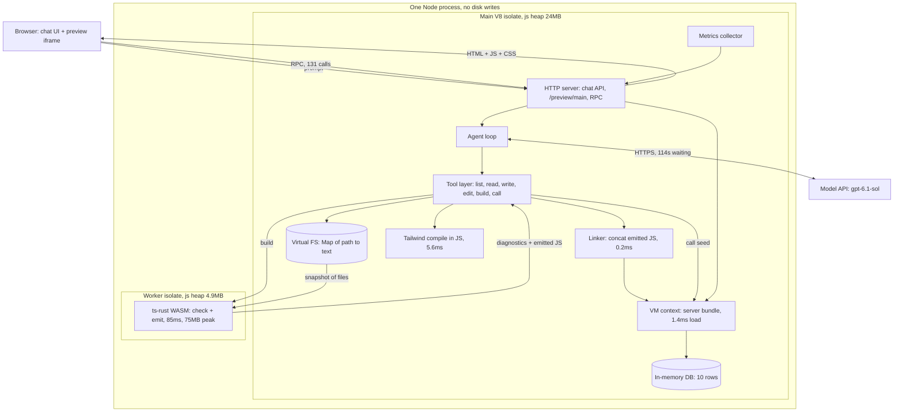

# 04 - Architecture reconstruction: what code exists and how to rebuild the demo

**One line:** the demo app itself is not public, but every hard part is (ts-rust has a working WASM build with an in-memory-files API, just-bash is on npm, Cloudflare Dynamic Workers load code at runtime), and the on-screen numbers are enough to reconstruct the build pipeline almost exactly.

Evidence labels: **SHOWN** (on screen, [MM:SS]), **SAID** (Theo, [MM:SS]), **VERIFIED** (primary source, URL or `repo/path@commit`), **INFERRED** (reasoning, not fact).

Commits inspected (shallow clones, read only, nothing built or run):

- `pingdotgg/ts-rust@91f3d02` (2026-10-28, "docs(state): landing done")
- `vercel-labs/just-bash@ec5ab76` (2026-11-20)

---

## 1. What is public vs not

| Artifact | URL | Status | Evidence |
|---|---|---|---|
| ts-rust compiler (native) | https://github.com/pingdotgg/ts-rust | Public, MIT, 1,695 stars, last push 2026-10-28 | VERIFIED `gh repo view pingdotgg/ts-rust` |
| `tsc-rs` npm package (native binaries) | https://www.npmjs.com/package/tsc-rs | Public, latest 0.8.0 (2026-10-21), maintainer `t3dotgg` | VERIFIED registry.npmjs.org/tsc-rs |
| `@tsc-rs/typescript` (drop-in for `typescript`) | https://www.npmjs.com/package/@tsc-rs/typescript | Public, 0.8.0 | VERIFIED registry |
| ts-rust WASM source (`crates/ts_wasm`, `npm/wasm`) | https://github.com/pingdotgg/ts-rust/tree/main/npm/wasm | Public source; first WASM commit 2026-10-02, repo public since 2026-10-07 | VERIFIED `ts-rust/npm/wasm/README.md@91f3d02` |
| ts-rust WASM npm package (`ts-rust-wasm`) | - | **Not published.** Registry returns "Not found"; README says "Nothing here publishes" | VERIFIED registry 404 for `ts-rust-wasm`, `@tsc-rs/wasm`, `tsc-rs-wasm` |
| Prebuilt `ts_rust.wasm` binary | - | **Not published.** Gitignored, not a release asset; you must build it | VERIFIED `npm/wasm/.gitignore@91f3d02`, release v0.8.0 asset list |
| just-bash | https://github.com/vercel-labs/just-bash | Public, Apache-2.0, npm `just-bash@3.6.1`, 4,507 stars | VERIFIED repo + registry |
| "isolate" demo app (Opus build) | - | **Not found** | Searched GitHub repos/code under `pingdotgg`, `t3dotgg`, and globally for `wasm-app-building`, `v8-isolate-app-builder`, `"@isolate/client"`, "isolate studio": no hits |
| "Isolate Studio" demo app (Astra build) | - | **Not found** | Same searches |
| Cloudflare Workers port of the demo | - | **Not found**; in progress at recording time | SHOWN [46:36-46:41] T3 Code thread "Typesafe App Builder in a V8 Isolate", project `wasm-app-building`, branch `t3/v8-isolate-app-builder-demo` |
| Lakebed (hinted [41:26]) | https://www.npmjs.com/package/lakebed , https://lakebed.dev | Public alpha since 2026-05-20, maintainer `t3dotgg`, latest 0.0.41; no public source repo field | VERIFIED registry.npmjs.org/lakebed |
| Follow-up video/post about the Workers port | - | **Not found** by web search. X/Twitter is not searchable from here, so this is "not found", not "does not exist" | - |

Third-party public code that already does parts of this on Cloudflare (independent of Theo, claims are theirs):

| Repo | What | Evidence |
|---|---|---|
| https://github.com/gingerhendrix/cf-ts-rust | ts-rust WASM type-checking inside a Cloudflare Worker; measured memory/CPU/limits | VERIFIED repo README (2026-10-08) |
| https://github.com/gingerhendrix/ts-codemode | Model writes TS, ts-rust WASM gates it, runs in a Dynamic Worker | VERIFIED repo README |
| https://github.com/moverperfect/jigworks | Full "agent builds an app" loop only in Workers isolates (ts-rust check, esbuild build, preview); source-available, not OSS | VERIFIED repo README + `docs/adr/` |
| `jmfrank63/rs3` -> `prototypes/iso-agents` | Agent loop inside one workerd isolate, cites this video; author of ts-rust PR #85 | VERIFIED repo README, https://github.com/pingdotgg/ts-rust/pull/85 |

---

## 2. ts-rust facts

| Fact | Detail | Label |
|---|---|---|
| What it is | Direct Rust port of Microsoft's Go TypeScript compiler (tsc, checker, LSP, API), pinned to `microsoft/TypeScript@3e92363` = TypeScript 7.1.0-beta | VERIFIED `README.md@91f3d02`, `UPSTREAM.md@91f3d02` |
| Workspace crates | `crates/ts_goport` (the compiler, 3 "parts" crates `goport_core`, `goport_util`, `goport_lsproto`, plus `goport_cell`), `crates/ts_wasm`, `tools/ts_ast_codegen`, `tools/ts_diagnostics_codegen` | VERIFIED `Cargo.toml@91f3d02` |
| Size | 1,190 `.rs` files, about 874k lines under `crates/` | VERIFIED counted in clone |
| Go stdlib port | `crates/ts_goport/src/gostd/` (context, errgroup, regexp, strconv, unicode, url, timer, runtime, ...) plus `gopanic.rs`, `gostring.rs` | VERIFIED dir listing @91f3d02 |
| Threading model (native) | Keeps Go's model: 4 checkers by default, `--checkers N`, `--fast` = one per core up to 16 | VERIFIED `README.md@91f3d02` |
| Effect plugin | Effect language-service diagnostics built in (codes 377xxx), port of `Effect-TS/tsgo` 0.51.1; on only when tsconfig lists `@effect/language-service` | VERIFIED `README.md@91f3d02`, `crates/ts_goport/src/effect/` |
| Native build | `cargo build --release -p ts_goport --bins`; bins `goport` and `tsgo`; shipped builds use fat LTO + PGO | VERIFIED `README.md`, `npm/README.md@91f3d02` |
| WASM target | `wasm32-wasip1`, `crates/ts_wasm` is a `cdylib`, **no wasm-bindgen**; raw ABI: exports `ts_input`, `ts_run`, `ts_output`, `ts_output_len`; imports `ts_host.fs`, `fs_take` + a small hand-written WASI shim (clock, random, stdout/stderr). No WASI filesystem | VERIFIED `crates/ts_wasm/src/lib.rs`, `host.rs`, `npm/wasm/core.js@91f3d02` |
| WASM build recipe | `rustup target add wasm32-wasip1`; binaryen `wasm-opt` >= 132; `scripts/wasm/build.sh` writes `npm/wasm/ts_rust.wasm` | VERIFIED `npm/wasm/README.md`, `scripts/wasm/build.sh@91f3d02` |
| WASM size (documented, not measured here) | 4.2 MB raw, 1.8 MB gzip, 1.5 MB brotli (opt-level z + wasm-opt); 5.2 MB variant checks 13-18% faster. `lib.*.d.ts` embedded as one LZMA stream (0.31 MB) | VERIFIED as documented in `npm/wasm/README.md@91f3d02`; binary not published so not independently measured |
| High-level API | `tsc(args, { files, cwd, diagnostics: "json", wasm })` -> `{ exitCode, stdout, stderr, diagnostics?, files? }`. `files` = Map/Record of absolute path -> text; result `files` includes emitted output | VERIFIED `npm/wasm/index.d.ts@91f3d02` |
| Low-level API | `runTsc(module, { args, cwd, fs, diagnosticsJson, ... })` (sync) and `runTscAsync` (JSPI) from `ts-rust-wasm/core`, with any `HostFileSystem` (`readFile`, `stat`, `readDirectory`, optional `writeFile`/`remove`/`realpath`) - all **synchronous** | VERIFIED `npm/wasm/core.d.ts@91f3d02` |
| Diagnostics shape | TypeScript API `DiagnosticResponse`: `fileName, pos, end, startPosition{line,character}, code, category(0-3), text, messageChain, relatedInformation`, UTF-16 offsets | VERIFIED `npm/wasm/core.d.ts@91f3d02` |
| Entry points | `node.js` (each run in a fresh `worker_threads` Worker with a 256 MB stack), `browser.js` (browser/Deno/worker; default export condition), `examples/browser/worker.js` (module Web Worker) | VERIFIED `npm/wasm/package.json`, `node.js`, `browser.js@91f3d02` |
| Threads in WASM | One thread. Checkers run their jobs inline on the caller (like Go `--singleThreaded`) | VERIFIED `npm/wasm/README.md@91f3d02` |
| One run per instance | New WASM instance per `tsc` call (compiler keeps one program per process); module compiled once. No incremental state between runs | VERIFIED `npm/wasm/README.md`, `crates/ts_wasm/src/lib.rs@91f3d02` |
| Stack limits | Deep expressions can overflow: Safari worker fails near 230 terms of `1 + 1 + ...`; ~1 MB hosts (Node main thread, workerd) are the weak spot; "hosts like workerd cannot raise the stack" | VERIFIED `npm/wasm/README.md`, https://github.com/pingdotgg/ts-rust/issues/99 (open, filed by `t3dotgg`) |
| Not supported in WASM | `--watch`, `--lsp`, `--api`, JSON diagnostics with `--build`, plugins that spawn processes, locales | VERIFIED `npm/wasm/README.md@91f3d02` |
| Reuse one instance for many runs | Open third-party PR #85 (5-13 ms warm re-check claimed in workerd); not merged | VERIFIED https://github.com/pingdotgg/ts-rust/pull/85 |
| Language service in WASM | PR #51 closed, not merged; module would grow to 6.2 MB | VERIFIED https://github.com/pingdotgg/ts-rust/pull/51 |
| In-memory FS is O(files) per dir lookup | `memoryFileSystem` scans every key for `stat`/`readDirectory`; open issues #205, #206 | VERIFIED `npm/wasm/core.js@91f3d02`, issue list |
| npm packages | `tsc-rs` (bin `tsc-rs`), `@tsc-rs/typescript`, platform packages `@tsc-rs/{linux,darwin,win32}-{x64,arm64}`; 10 versions since 2026-10-03 | VERIFIED registry + `npm/README.md@91f3d02` |
| License | MIT (repo); crates declare `MIT AND Apache-2.0`; Go stdlib parts BSD-3-Clause | VERIFIED `LICENSE`, `Cargo.toml`, `README.md@91f3d02` |
| Maintenance | Last commit 2026-10-28; last release 0.8.0 on 2026-10-21; 100 open issues (most filed 2026-11-05 to 11-21), 9 open PRs, nothing merged since 2026-10-28 | VERIFIED `gh issue list`, `gh pr list`, `gh release list` |
| Older docs in repo | `ts-rust-recovery-plan.html` describes an earlier failed state (70 failing tests, slower than Go); `recommendations.md` is a dev-loop audit from 2026-09-28. Historical, not current status | VERIFIED files @91f3d02 |

---

## 3. just-bash facts

| Fact | Detail | Label |
|---|---|---|
| What it is | Bash interpreter + in-memory filesystem in TypeScript, "designed for AI agents"; beta | VERIFIED `packages/just-bash/README.md@ec5ab76` |
| Core API | `new Bash({ files, env, cwd, fs, customCommands, network, python, javascript, executionLimits })`; `await bash.exec(script, { env, cwd, stdin, args, signal })` -> `{ stdout, stderr, exitCode }` | VERIFIED README @ec5ab76 |
| State model | Each `exec()` gets fresh shell state (env, cwd, functions); the **filesystem persists** across calls | VERIFIED README @ec5ab76 |
| Filesystems | `InMemoryFs` (default, supports lazy file providers), `OverlayFs` (disk read, memory write), `ReadWriteFs` (real disk), `MountableFs` (compose) | VERIFIED README @ec5ab76 |
| FS interface | `IFileSystem` is **async** (`readFile`, `writeFile`, `stat`, `readdir`, `getAllPaths()`, ...) | VERIFIED `packages/just-bash/src/fs/interface.ts@ec5ab76` |
| Custom commands | `defineCommand(name, async (args, ctx) => ({ stdout, stderr, exitCode }), { trusted? })`; `ctx` has `fs`, `cwd`, `env`, `stdin`, `exec` | VERIFIED `src/custom-commands.ts@ec5ab76` |
| Commands implemented | ~80: file ops (`cat cp ls mkdir mv rm find tree ...`), text (`grep rg sed awk sort uniq wc diff head tail xargs ...`), data (`jq yq xan sqlite3`), `tar gzip`, shell builtins; pipes, redirects, functions, loops, globs | VERIFIED README + `src/commands/` @ec5ab76 |
| Not there | No `node`, `npm`, `git`, `tsc`, no real processes or binaries | VERIFIED command list @ec5ab76 |
| Optional runtimes | `curl` (only with a network allow-list), `js-exec` (QuickJS in WASM, 64 MB cap), `python3` (CPython WASM), `sqlite3` (sql.js) | VERIFIED README @ec5ab76 |
| Security model | No VM isolation; runs in the host JS realm with defense-in-depth; network off by default; "Use Vercel Sandbox if you need a full VM" | VERIFIED README "Security Model", `THREAT_MODEL.md@ec5ab76` |
| Limits | Configurable: command count, call depth, output size, FS bytes (default examples 256 MB), wall-clock deadline 30 s | VERIFIED README "Execution Protection" @ec5ab76 |
| Browser | Core shell + FS work via `just-bash/browser`; unavailable: `python3`, `sqlite3`, `js-exec`, `OverlayFs`, `ReadWriteFs`, `tar`, `yq`, `xan`; gzip fails at runtime | VERIFIED README, `src/browser.ts`, `src/commands/browser-excluded.ts@ec5ab76` |
| Cloudflare Workers | **Not stated anywhere in the repo** (no "cloudflare"/"workerd" mention). Untested claim either way | VERIFIED by grep @ec5ab76 |
| Bundle size | `dist/bundle/browser.js` 1.26 MB minified; Node ESM entry 0.52 MB + 1.5 MB chunks; whole package 21.7 MB unpacked (10.4 MB is vendored CPython) | VERIFIED data.jsdelivr.com file list for `just-bash@3.6.1` |
| Agent wrapper | `bash-tool` (`createBashTool({ files })`) for the AI SDK; `Sandbox` class mimics `@vercel/sandbox` | VERIFIED README @ec5ab76 |
| Author | "Malte and Claude" in package.json; npm maintainer `cramforce` | VERIFIED `packages/just-bash/package.json@ec5ab76`, registry |

---

## 4. What the video actually shows about the demo

Two different apps. Do not merge them.

| | "isolate" (Opus build) | "Isolate Studio" (Astra build) |
|---|---|---|
| Header | `isolate gpt-6.1-sol`, tabs Preview / Code, path `/preview/main` SHOWN [32:44] | Tabs Code / Preview / Resources; Preview / Database / Logs; a "Build" button SHOWN [02:12], [31:42] |
| Files | `server/index.ts`, `client/index.tsx` SHOWN [32:48] | `server.ts`, `client.tsx`, `styles.css` SHOWN [02:12] |
| Client code | Not shown | React: imports `react`, `react-dom/client`, `createClient` from `@isolate/client`, `import type { api as ServerApi } from './server'`, calls `api.list({})` SHOWN [02:12] |
| Tool steps | Listed files; Read x2; Wrote x2; Edited x3; "Build failed 1 type error 83ms"; "Built type check, bundle, deploy 92ms"; "Called seed()" 0.9ms; "Called tasks()" 0.4ms; 13th step collapsed SHOWN [32:48] | read files; write files; build; "Build passed - ts-rust WASM"; inspect preview; read logs SHOWN [31:42] |
| Build numbers | ts-rust check 85ms; wasm memory peak 75MB; bundle 35KB client 0.2ms; tailwind 17KB 5.6ms; load into vm 1.4ms SHOWN [33:23] | TYPECHECK 162 ms; BUNDLE 116 ms SHOWN [31:42] |
| Process | rss 259MB; js heap main isolate 24MB; js heap ts-rust worker 4.9MB; cpu split "main / ts-rust / other" all 0% SHOWN [33:23] | PROCESS RAM 422.6-423.8 MB; CPU 0.2-0.3% SHOWN [02:12], [31:42] |
| Runtime data | rpc calls 131, 0.2ms avg; database 10 rows, 2.6KB SHOWN [33:23] | Database tab exists; content not shown |
| Agent | waiting on the model 114.4s; tools in this isolate 178ms; turns 13; tokens 78.3k in / 5.2k out; reasoning tokens 156 SHOWN [33:23] | - |
| Bundler | Not named | esbuild SAID [33:43] |
| Host | "running in Node on a server technically" SAID [32:42] | Not said |

"Versus a process each" table SHOWN [33:25] (wall / cpu / mem): ts-rust wasm 85ms / 81ms / 79MB; tsc 6 (JS) 291ms / 631ms / 142MB; tsc 7 (Go) 56ms / 111ms / 46MB; tsc-rs native 42ms / 42ms / 43MB; Node container 541ms / - / 13MB. How these comparison rows were measured is not shown (live or pre-recorded: unknown).

Gaps between SAID and SHOWN:

- RAM: "under 216 megs" SAID [33:12] vs 259MB SHOWN [33:23].
- CPU: "peaked at like 4%" SAID [33:12]; panel shows 0% at rest SHOWN. Peak is not visible in any frame.
- "2x the RAM" for the esbuild build SAID [33:43]; 423.8 / 259 = 1.64x SHOWN.
- Note the WASM checker is **slower** than native Go tsc in Theo's own table (85ms vs 56ms). The win shown is "no second process", not speed. INFERRED from the SHOWN table.

Arithmetic that pins the pipeline (INFERRED, from SHOWN numbers):

- 85 (check) + 0.2 (bundle) + 5.6 (tailwind) + 1.4 (vm load) = 92.2 ms = the "Built ... 92ms" step. So "build" is exactly those four stages, in one process.
- Sum of visible step times = 177.4 ms, matching "tools in this isolate 178ms". Everything else (114.4 s) is waiting on the model: tools are 0.16% of the turn.
- A 0.2 ms "bundle" cannot be esbuild/rolldown (the Astra build's esbuild bundle takes 116 ms). It is a string-concatenation step over JS that already exists, so the TS->JS transpile must be ts-rust's own emit inside the 85 ms.
- The failed build took 83 ms and has no bundle stage: check fails -> stop.

Bash: just-bash is presented as the inspiration [31:40-32:11], [39:24]. **No bash command appears in either step log**; both agents use file tools plus build. Whether just-bash is wired into the demo is not shown.

Lakebed link (INFERRED, strong): the Opus build's file layout `server/index.ts` + `client/index.tsx` is exactly Lakebed's documented "capsule shape", Lakebed is Tailwind-only styling with Preact, has typed `createClient<typeof app>()` RPC and a built-in table database (VERIFIED lakebed@0.0.41 README and template `AGENTS.md` on cdn.jsdelivr.net). A 35KB client bundle fits Preact + app code, not React DOM. Theo declines to confirm at [41:26]. Lakebed's published CLI depends on `esbuild`, `tailwindcss`, `@tailwindcss/oxide`, `preact`, `ws` (VERIFIED registry), i.e. today it builds with native tools; the demo looks like the same app model with the native tools swapped out.

---

## 5. Reconstructed architecture

Everything below the SHOWN rows is a reconstruction. The source is not public.



### Component table

| Component | Job | Likely implementation | Evidence |
|---|---|---|---|
| Chat UI | Prompt box, step log with per-step ms, summary, model label | Web app served by the same process | SHOWN [32:44] |
| Agent loop | Send messages + tool schemas, run returned tool calls, repeat; 13 turns | Plain tool-calling loop over HTTPS to an OpenAI-family model. Routed through something called "cliproxy" in Theo's setup | Turns/tokens SHOWN [33:23]; "tunnel to cliproxy, or use a direct API key" SHOWN [46:40]; loop shape INFERRED |
| Tool layer | `list files`, `read`, `write`, `edit`, `build`, `call fn()` | Small JS functions over the VFS; 0.1-0.2 ms each | Step names + timings SHOWN [32:48]; implementation INFERRED |
| Virtual filesystem | Holds the project; nothing touches disk | `Map<string,string>` (or just-bash `InMemoryFs`); starts from a template, since the agent reads `server/index.ts` before writing it | "Nothing here left RAM" SAID [34:45]; read-before-write SHOWN [32:48]; structure INFERRED |
| Bash emulation | Give the agent `ls/grep/sed` over the VFS | just-bash `Bash` sharing the same FS | Inspiration SAID [31:40], [39:24]; **use in demo not shown** |
| Typecheck worker | Type-check and emit JS | ts-rust WASM in a `worker_threads` Worker (a second V8 isolate in the same process) | "js heap, ts-rust worker 4.9MB", "wasm memory peak 75MB", "ts-rust check 85ms" SHOWN [33:23]; ts-rust's Node entry does run each check in a Worker VERIFIED `npm/wasm/node.js@91f3d02` |
| Transpile | TS/TSX -> JS | ts-rust's own emit (the in-memory run returns emitted files) | API returns emitted files VERIFIED `npm/wasm/index.d.ts@91f3d02`; use in demo INFERRED from timing |
| Bundler | One client script (35KB) and one server script | Opus build: tiny module-registry concat over emitted JS, runtime (Preact-like + RPC client) prebuilt. Astra build: esbuild (Go compiled to WASM or native) | 0.2ms SHOWN [33:23]; esbuild SAID [33:43]; concat design INFERRED |
| Tailwind step | Produce 17KB CSS from class names in source | `tailwindcss` v4 `compile(css)` then `.build(candidates)` in plain JS, own class scanner | "tailwind 17KB 5.6ms" SHOWN [33:23]; `compile` signature VERIFIED `tailwindcss@4.3.5/dist/lib.d.mts`; scanner INFERRED |
| Load server bundle | Run generated server code without a new process | `node:vm` context (`vm.createContext` + `runInContext`) | "load into vm 1.4ms" SHOWN [33:23]; API choice INFERRED |
| RPC | Typed calls from preview client to server functions | Client `createClient<typeof ServerApi>()` proxy -> HTTP POST (or websocket) -> function in VM context; the agent's `call` tool uses the same path | `createClient` + `import type` SHOWN [02:12] (Astra build); "rpc calls 131, 0.2ms avg" and "Called seed()" SHOWN [33:23], [32:48]; transport INFERRED |
| In-memory database | Tables for the generated app | JS arrays/Maps behind a small table API; counted as rows + bytes | "database 10 rows 2.6KB" SHOWN [33:23]; implementation INFERRED |
| Preview serving | Show the built app | Route `/preview/main` returns HTML shell + client bundle + CSS; "deploy" = swap the current bundle in memory | Path SHOWN [32:44]; "type check, bundle, deploy" SHOWN [32:48]; mechanism INFERRED |
| Metrics | Footer + "stats for nerds" | `process.memoryUsage()` (rss), per-isolate heap stats, per-thread CPU, `WebAssembly.Memory` size, timers around each stage | Fields SHOWN [33:23]; APIs INFERRED |

### One full turn, traced

| # | What happens | Where it runs | Evidence |
|---|---|---|---|
| 1 | User types "A kanban board with drag and drop" | Browser -> HTTP | SHOWN [32:44] |
| 2 | Loop sends prompt + tool schemas to the model, waits | Main isolate idle; CPU ~0% | "waiting on the model 114.4s" SHOWN |
| 3 | Model calls list files, read `server/index.ts`, read `client/index.tsx` | VFS, 0.1-0.2 ms each | SHOWN [32:48] |
| 4 | Model writes both files, then edits `client/index.tsx` twice | VFS | SHOWN |
| 5 | Model calls build. Files go to the ts-rust worker; checker returns 1 diagnostic; no bundle | Worker isolate, 83 ms | "Build failed 1 type error 83ms" SHOWN |
| 6 | The diagnostic text is returned as the tool result; model edits `client/index.tsx` | VFS, 0.1 ms | Edit SHOWN; diagnostic-as-tool-result INFERRED |
| 7 | Build again: check + emit 85 ms -> concat 0.2 ms -> Tailwind 5.6 ms -> load server into VM 1.4 ms -> preview now serves the new bundle | Worker + main isolate, 92 ms | "Built type check, bundle, deploy 92ms" + Build 3 panel SHOWN |
| 8 | Model calls `seed()`: server function inserts sample rows | VM context -> in-memory DB, 0.9 ms | "Called seed()" SHOWN; 10 rows SHOWN |
| 9 | Model calls `tasks()` to confirm data comes back | VM context, 0.4 ms | "Called tasks()" SHOWN [32:48] |
| 10 | Model writes the summary; preview iframe loads, client calls server over RPC | Browser <-> main isolate | Summary SHOWN [32:52]; 131 rpc calls SHOWN |

"Build 3" in the panel while the log shows two builds: the hidden 13th step or an earlier build likely accounts for it. Not resolvable from the frames.

---

## 6. What makes it isolate-only

| A normal agent sandbox uses | Replaced here by | Label |
|---|---|---|
| Disk filesystem | In-memory map of path -> text; lost on restart | SAID [34:45], [39:54]; structure INFERRED |
| Shell + coreutils (`ls`, `rg`, `sed`) | Purpose-built file tools; just-bash for a real shell feel | Tools SHOWN [32:48]; just-bash SAID [31:40] |
| `tsc` process | ts-rust WASM in a worker isolate | SHOWN [33:23] |
| Transpiler | ts-rust emit (same run as the check) | INFERRED |
| Bundler process (esbuild/vite) | String concat linker (Opus build) or esbuild in-process (Astra build, +165MB RSS) | SHOWN numbers; SAID [33:43] |
| PostCSS/Tailwind CLI (native oxide scanner) | Tailwind's JS compiler + a JS class scanner | SHOWN [33:23]; INFERRED |
| Dev server process on a port | A route on the host's existing HTTP server (`/preview/main`) | SHOWN [32:44] |
| `node server.js` child process | Server bundle evaluated in a VM context | SHOWN "load into vm" |
| Postgres/SQLite process or file | In-memory tables | SHOWN "database 10 rows" |
| Package manager (`npm install`) | Nothing: no installs are shown; runtime libs are baked in | No install step SHOWN; baked-in runtime INFERRED |
| Network egress for the agent | Not exposed as a tool in the demo; only the host calls the model | No network step SHOWN; INFERRED |
| Process isolation between tenants | V8 isolate boundary only (and `node:vm` is weaker than that, see section 8) | SAID [29:06-29:36]; caveat VERIFIED https://nodejs.org/api/vm.html |
| Idle CPU reservation | Shared event loop; waiting on tokens costs no CPU | SAID [40:24-40:55]; 114.4 s wait vs 178 ms tools SHOWN |

The one thing still read from disk in the Node demo: the server's own code and `ts_rust.wasm` at startup. A read-only filesystem is enough, which is the exact claim made [39:54].

---

## 7. Building blocks for a rebuild

| Need | Option | Runs in an isolate? | Cost / catch | Label |
|---|---|---|---|---|
| Type check + emit | ts-rust WASM (`npm/wasm`) | Yes: Node, browser, workerd | 4.2 MB module (documented); build it yourself; ~1 MB stack hosts are fragile; 55.9 MiB linear memory for one file with default 4 checkers, 24.3 MiB with `--checkers 1` + smaller shadow stack (third-party measurement) | VERIFIED `npm/wasm/README.md@91f3d02`; memory numbers VERIFIED as claimed in gingerhendrix/cf-ts-rust README |
| Type check, fallback | TypeScript 6 (pure JS) with an in-memory host | Yes | Slower and heavier per Theo's table (291 ms, 142MB); has a language service | SHOWN [33:25]; TS6 works in Workers VERIFIED as stated in jigworks `docs/adr/0002` |
| Bundler | Hand-rolled concat of tsc-emitted modules | Yes, pure JS | No npm dependency graph, no tree shaking | INFERRED from 0.2 ms |
| Bundler | `esbuild-wasm@0.28.2` | Yes | `esbuild.wasm` is 13.98 MB; Go runtime memory is not returned (12-43 MB per jigworks) | Size VERIFIED data.jsdelivr.com; memory VERIFIED as claimed in jigworks `docs/adr/0010` |
| Bundler | `@rolldown/browser@1.3.3` | Yes (WASI + threads runtime shim) | 12.65 MB wasm | Size VERIFIED data.jsdelivr.com; workerd support not checked |
| Transpile only | `sucrase` (pure JS, 1.1 MB unpacked), `@swc/wasm-typescript` (4.05 MB), `oxc-transform` wasm binding (~4 MB) | Yes | No type check, no bundling | Sizes VERIFIED registry; behaviour not tested |
| Tailwind | `tailwindcss@4.3.5` `compile(css, opts)` -> `{ build(candidates: string[]): string }` | Yes, plain JS (`dist/lib.mjs` 257 KB) | You supply the class scanner (official one is native/threads); no `@plugin`; API is "internal" per Tailwind | Signature VERIFIED published `.d.mts`; caveats VERIFIED as stated in jigworks `docs/adr/0007` |
| Tailwind, lazy | `@tailwindcss/browser` (287 KB script) inside the preview page | Yes (browser only) | CSS generated in the preview at runtime, no build stat | Size VERIFIED data.jsdelivr.com |
| Database | Plain JS Maps/arrays | Yes | No SQL, no persistence | INFERRED |
| Database | `sql.js` (SQLite compiled to WASM/asm.js; asm.js build is 1.44 MB, wasm size not checked) / `@electric-sql/pglite` (26.9 MB unpacked) | Yes | Memory hungry; PGlite is far beyond a 2.6KB demo DB | Sizes VERIFIED registry |
| Database on Cloudflare | Durable Object SQLite storage / Dynamic Worker "Durable Object Facets" | Platform service | Persists, unlike isolate memory | VERIFIED https://developers.cloudflare.com/dynamic-workers/ index |
| Run generated server code (Node) | `node:vm` | Same isolate, new context | "not a security mechanism"; `timeout` option exists; ESM needs `--experimental-vm-modules` | VERIFIED https://nodejs.org/api/vm.html |
| Run generated server code (Node) | `worker_threads` with `resourceLimits` | Separate isolate, same process | Worker has Node APIs unless you strip them; not a sandbox by itself | INFERRED (not re-verified in docs) |
| Run generated server code (Node) | `isolated-vm@7.0.2` | Separate isolate with memory cap | Native addon (21 MB unpacked), so not "just JS" | Size VERIFIED registry; properties not re-verified |
| Run generated server code (any) | QuickJS in WASM (`quickjs-emscripten`; just-bash `js-exec`) | Yes | Interpreter speed; real boundary with memory cap | just-bash use VERIFIED README @ec5ab76 |
| Run generated server code (Cloudflare) | Dynamic Workers: `env.LOADER.get(id, () => WorkerCode)` | New isolate per code version | Workers Paid only; modules as strings, `{js}`, `{cjs}`, `{text}`, `{data}`, `{json}`, `{wasm: ArrayBuffer}`; `globalOutbound: null` blocks network | VERIFIED https://developers.cloudflare.com/dynamic-workers/api-reference/ , /pricing/ |
| Build + serve on Cloudflare, prepackaged | `@cloudflare/worker-bundler` (`createWorker`, `createApp`) | workerd only | Ships esbuild.wasm (13.9 MB) + TypeScript JS (4.6 MB); "Experimental" | VERIFIED package README + file list on cdn.jsdelivr.net |

---

## 8. Minimal rebuild plan

Everything in code blocks here is an **unverified sketch**: nothing was built or run. Calls marked `// VERIFIED sig` have signatures confirmed from source; the glue is not.

### Shared core (all targets)

1. Build `ts_rust.wasm` from `pingdotgg/ts-rust` (`scripts/wasm/build.sh`; needs Rust `wasm32-wasip1` + binaryen). There is no npm package to install.
2. Keep the project as one `Map<string, string>`. Preload: a template (`server/index.ts`, `client/index.tsx`, `tsconfig.json`) and the `.d.ts` files your runtime exposes (JSX runtime types, your RPC client types). TypeScript's own `lib.*.d.ts` are already inside the wasm (VERIFIED README).
3. Expose 6 tools to the model: `list_files`, `read_file`, `write_file`, `edit_file`, `build`, `call`.
4. `build` = check+emit with ts-rust -> link emitted JS -> Tailwind -> load server -> swap preview.
5. Return diagnostics to the model as the `build` tool result; cap retries.

```ts
// UNVERIFIED SKETCH
import { tsc } from "ts-rust-wasm";                 // VERIFIED sig: npm/wasm/index.d.ts@91f3d02 (not on npm)
import { compile } from "tailwindcss";              // VERIFIED sig: tailwindcss@4.3.5 dist/lib.d.mts

type Files = Map<string, string>;
type BuildResult =
  | { ok: false; ms: number; errors: { file?: string; line?: number; code: number; text: string }[] }
  | { ok: true; ms: number; clientJs: string; serverJs: string; css: string };

async function build(files: Files): Promise<BuildResult> {
  const t0 = performance.now();
  // Pass a COPY: the browser entry writes emitted files into the same Map (VERIFIED browser.js/core.js).
  const run = await tsc(["-p", "/app", "--checkers", "1"], { files: new Map(files), diagnostics: "json" });
  const errors = (run.diagnostics ?? []).filter(d => d.category === 1);
  if (errors.length) {
    return { ok: false, ms: performance.now() - t0,
      errors: errors.map(d => ({ file: d.fileName, line: d.startPosition?.line, code: d.code, text: d.text })) };
  }
  const out = run.files!;                            // includes /app/out/**.js when tsconfig sets outDir
  const clientJs = link(out, "/app/out/client/index.js");   // your concat linker
  const serverJs = link(out, "/app/out/server/index.js");
  const tw = await compile('@import "tailwindcss";', { loadStylesheet });  // you must serve tailwind's css from memory
  const css = tw.build(scanClassCandidates(files));         // your scanner: any token that might be a class
  return { ok: true, ms: performance.now() - t0, clientJs, serverJs, css };
}
```

Linker idea (unverified): have tsconfig emit CommonJS-style modules, wrap each emitted file as `function (require, module, exports) { ... }` in one object keyed by path, add a 20-line `require`. That is a string join, which is what a 0.2 ms "bundle" implies. Whether TypeScript 7.1 output settings make this painless was not checked.

If you also want a shell: just-bash's FS is async and ts-rust's host FS is sync (both VERIFIED), so they cannot share one object directly. Either keep the `Map` as the source of truth and give just-bash a thin `IFileSystem` over it, or snapshot `bash.fs.getAllPaths()` + `readFile` into a Map before each build.

```ts
// UNVERIFIED SKETCH - exposing the VFS as bash to the model
import { Bash, defineCommand } from "just-bash";    // VERIFIED sig: README + src/custom-commands.ts@ec5ab76
const bash = new Bash({ files: Object.fromEntries(files), cwd: "/app",
  customCommands: [defineCommand("build", async () => {
    const r = await build(await snapshot(bash));
    return { stdout: JSON.stringify(r), stderr: "", exitCode: r.ok ? 0 : 1 };
  })] });
// tool: bash({ script }) -> await bash.exec(script)
```

### Target A: Node, single process (what the video shows)

| Step | How | Label |
|---|---|---|
| 1 | `node:http` server: `/` chat UI, `/api/chat` (stream steps), `/preview/main` HTML, `/preview/main/rpc` POST | INFERRED |
| 2 | ts-rust: the package's Node entry already spawns a Worker per run with a 256 MB stack | VERIFIED `npm/wasm/node.js@91f3d02` |
| 3 | Load server bundle: `vm.createContext({ db, console })`, `vm.runInContext(serverJs, ctx, { timeout })`, keep `module.exports` as the function table | APIs VERIFIED nodejs.org/api/vm.html; usage sketch unverified |
| 4 | `call` tool and preview RPC both do `await fns[name](...args)` | INFERRED |
| 5 | Metrics: `process.memoryUsage().rss`, `v8.getHeapStatistics()`, worker heap via `worker.getHeapStatistics()`, wasm bytes from `memory.buffer.byteLength` | INFERRED; API names not re-verified |

- Blocked: nothing.
- Risky: `node:vm` is not a sandbox, so model-written server code can reach the host realm; fine for a local demo, not for multi-tenant. One Node process per user also throws away the density argument; the density only appears when many users share one process, which needs a real boundary (worker isolates with limits, `isolated-vm`, or QuickJS).
- Baseline cost: 259MB RSS for one session is mostly Node itself; isolate heaps total ~29MB + 75MB wasm peak (SHOWN [33:23]).

### Target B: browser tab

| Step | How | Label |
|---|---|---|
| 1 | Agent loop + VFS in a module Web Worker (or the page) | INFERRED |
| 2 | ts-rust in its own module Web Worker via `browser.js`; serve `ts_rust.wasm` as `application/wasm` so it stream-compiles | VERIFIED `npm/wasm/browser.js`, `examples/browser/worker.js@91f3d02` |
| 3 | Server bundle runs in a third Worker created from a Blob URL; RPC over `postMessage` | INFERRED |
| 4 | Preview: simplest is `<iframe sandbox srcdoc>` with inlined JS+CSS and a `postMessage` RPC bridge. A real `/preview/main` URL needs a Service Worker that answers fetches from memory | INFERRED |
| 5 | Persistence: none by default; add OPFS/IndexedDB if wanted | INFERRED |

- Blocked: calling a model API with a secret key from the page (key is exposed; many providers block browser CORS). You need a thin proxy or a user-supplied key. Theo flags CORS as the tab-only exception [38:53] SAID.
- Risky: Safari workers have a small stack and no JSPI, ts-rust fails on deep expressions there (VERIFIED README). Service Worker scope/first-load quirks. just-bash in browser lacks `sqlite3`, `js-exec`, `python3`, `tar`, working gzip (VERIFIED).
- Upside: the browser gives real isolation for generated code (sandboxed iframe, separate Workers) for free.

### Target C: Cloudflare Worker

Limits that bite:

| Limit | Value | Effect here | Label |
|---|---|---|---|
| Memory | 128 MB per isolate, JS heap + WASM together | ts-rust alone peaks at 75MB in the demo [33:23]; a check after an esbuild build exceeded 128 MB in jigworks' tests | VERIFIED https://developers.cloudflare.com/workers/platform/limits/ ; jigworks `docs/adr/0010` |
| Over the limit | Isolate is replaced after in-flight requests; in-memory state is gone | Never keep the VFS only in isolate memory | VERIFIED same limits page |
| CPU time | 10 ms Free; 30 s default, 5 min max on Paid | One check is 85 ms+ of CPU (130-850 ms measured by cf-ts-rust), so Paid is required | VERIFIED limits page; cf-ts-rust README |
| Startup | 1 s to run global scope | Do not instantiate/typecheck at module top level | VERIFIED limits page |
| Script size | Limits page (fetched 2026-11-25) says 64 MiB uncompressed and no compressed limit; cf-ts-rust README (Oct 2026) still cites a 3 MB gzip free-plan limit | Conflicting sources; ts-rust (1.8 MB gzip) fits either way, esbuild.wasm (14 MB raw) only under the newer rule | Both VERIFIED as written; which is current: unverified |
| `eval`, `new Function` | Not allowed | Cannot run model-written JS inside your own Worker | VERIFIED https://developers.cloudflare.com/workers/runtime-apis/web-standards/ |
| `WebAssembly.compile` / `instantiate(bytes)` | Not allowed | Import `ts_rust.wasm` statically (wrangler gives a compiled `WebAssembly.Module`), then `new WebAssembly.Instance` per run | Ban VERIFIED same page; static import pattern VERIFIED as used in cf-ts-rust `src/index.ts` per its README |
| Sanctioned dynamic code | Dynamic Workers (Worker Loader binding): `env.LOADER.get(id, async () => ({ compatibilityDate, mainModule, modules, env, globalOutbound }))` then `worker.getEntrypoint().fetch(req)` | This is "load into vm" on Cloudflare | VERIFIED https://developers.cloudflare.com/dynamic-workers/api-reference/ |
| Dynamic Worker availability | Workers Paid only; 1,000 unique Dynamic Workers/day included, then $0.002 each per day; max 4 concurrent per Worker request, 10 per Durable Object | Every new build = new code = new billable Dynamic Worker | VERIFIED /dynamic-workers/pricing/ and /platform/limits/ |
| Clock | `performance.now()` / `Date.now()` do not advance during CPU work | The demo's per-stage ms would all read 0; use platform observability | VERIFIED web-standards page; cf-ts-rust README |
| Stack | ~1 MB, cannot be raised, no `worker_threads` | Deep expressions can crash a check | VERIFIED ts-rust issue #99 |

Plan:

| Step | How | Label |
|---|---|---|
| 1 | One Durable Object per workspace: owns the VFS (SQLite storage), chat history, runs the agent loop (waiting on the model costs no CPU) | INFERRED; same shape as jigworks `docs/adr/0003` |
| 2 | Checker in its **own** Dynamic Worker (own 128 MB): static `ts_rust.wasm` module + `runTsc(module, { fs: memoryFileSystem(files), args: ["-p","/app","--checkers","1"], diagnosticsJson: true })` | `runTsc`/`memoryFileSystem` VERIFIED `npm/wasm/core.d.ts@91f3d02`; separate-isolate advice VERIFIED jigworks `docs/adr/0010` |
| 3 | Link + Tailwind in the DO (plain JS). Theo's agent was running "Test Tailwind compile in workerd" at recording time; outcome not shown | SHOWN [46:40] |
| 4 | Generated server: `env.LOADER.get(buildHash, () => ({ mainModule: "server.js", modules: { "server.js": serverJs }, globalOutbound: null, env: { DB: stub } }))` | API VERIFIED; composition is an unverified sketch |
| 5 | Preview: route `/preview/:id/*` on the host Worker; HTML/JS/CSS from the DO; RPC forwarded to the Dynamic Worker | INFERRED |
| 6 | App database: Durable Object storage (or Facets). In-memory is acceptable only if "State being wiped is fine", which is what Theo told the agent | SHOWN [46:40] |
| 7 | Model: Workers AI or an outbound `fetch` with a secret. On screen: "Workers AI GLM 5.3", and "inference built in on Cloudflare or ... openrouter" | SHOWN [46:40] |

```ts
// UNVERIFIED SKETCH - host Worker side
import tsRust from "./ts_rust.wasm";                         // compiled WebAssembly.Module via the Workers module loader
import { runTsc, memoryFileSystem } from "./ts-rust/core.js"; // VERIFIED sig: npm/wasm/core.d.ts@91f3d02

function check(files: Map<string, string>) {
  const fs = memoryFileSystem(new Map(files));
  const { exitCode, diagnostics } = runTsc(tsRust, {
    args: ["-p", "/app", "--checkers", "1"], cwd: "/", fs, diagnosticsJson: true });
  return { exitCode, diagnostics, out: fs.files };
}

function loadApp(env: Env, hash: string, serverJs: string) {  // VERIFIED API shape: dynamic-workers/api-reference
  return env.LOADER.get(hash, async () => ({
    compatibilityDate: "2026-11-01", mainModule: "server.js",
    modules: { "server.js": serverJs }, globalOutbound: null }));
}
```

- Blocked: running generated code in the same isolate (no `eval`); anything on the Free plan (CPU + Dynamic Workers).
- Risky: 128 MB (ts-rust with real dependencies' types: zod 4.6.5 needed 153-234 MiB, Effect never fit, per cf-ts-rust); silent isolate replacement on overflow; 1 MB stack; reported `Uint8Array.subarray` failure past 128 MiB in upstream `core.js` on hosted Workers (third-party claim, not reproduced); no per-stage timing; per-build Dynamic Worker billing; just-bash on workerd untested.
- Theo's "would be fully possible ... in a Cloudflare worker" [39:54] is SAID, not SHOWN: at [46:35] the port is described as something he "just told Opus" to do, and the visible thread is still asking setup questions.

---

## 9. Open questions and what needs testing

- Does the demo use just-bash at all, or only bespoke file tools? (No bash step is shown.)
- Is the Opus build literally the Lakebed capsule runtime with ts-rust swapped in? (Layout matches; unconfirmed.)
- What is the 0.2 ms "bundle": concat of tsc output (my reading) or something else? Which module format does it emit?
- How is React/Preact supplied to a 35KB client bundle: Preact inside the 35KB, or a prebuilt vendor script outside the count?
- Is `node:vm` the "vm" in "load into vm", and is there any isolation between generated server code and the host?
- How were the "Versus a process each" rows produced (live child processes would contradict "nothing left V8")?
- What is the 13th step, and why "Build 3" with two builds visible?
- Does ts-rust WASM hold up with real dependency types under 128 MB, and how many checks per second per isolate? Needs measuring with your own template + `.d.ts` set.
- Does just-bash's browser bundle run on workerd (with or without `nodejs_compat`)?
- Does Tailwind v4 `compile()` run in workerd within CPU limits, and how good is a regex class scanner in practice?
- Can PR #85 (instance reuse) or an equivalent cut warm checks from ~85-180 ms to ~10 ms? It is unmerged.
- Which Worker script-size rule is current (3 MB gzip vs 64 MiB uncompressed)?
- Security: none of the Node-side pieces (just-bash, `node:vm`) claim to be a hard boundary. A multi-tenant version needs one.

## 10. Not verified / could not check

- The demo source, its exact tool schemas, system prompt, RPC transport, DB implementation: not public.
- ts-rust WASM size and speed: taken from the repo's README; no binary is published and nothing was built here.
- Third-party numbers (cf-ts-rust, jigworks, iso-agents): quoted from their READMEs/ADRs, not reproduced.
- Cloudflare limit values come from machine-summarized fetches of the official docs pages on 2026-11-25; re-read the pages before relying on a number.
- X/Twitter posts by Theo after 2026-10-10: not searchable from this environment.
- "Astra" spelling and which exact model built Isolate Studio: only SAID [31:40].
- Address bar host of the demo (starts "bb-1.po...") is cut off by the webcam overlay [32:44]; unreadable.
