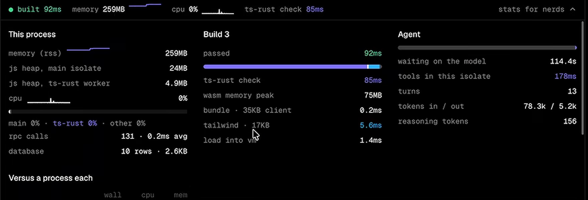

# Theo: ts-rust, V8 isolates, and the browser as an agent's computer

**One line:** Theo ported the TypeScript 7 compiler to Rust mainly so it compiles to a small WASM module, then used it to show a coding agent building and running a full-stack app with the whole dev loop (files, typecheck, bundle, server, DB) inside one Node process of V8 isolates, with no VM or container per agent.

Analysis of [You can rewrite typescript in rust for $420k](https://www.youtube.com/watch?v=ND_kRgU_WlY) (Theo - t3.gg, 47:40, uploaded 2026-10-10). Analysed 2026-11-25. Original notes, not a transcript; not affiliated with the creator.

Evidence labels used in every file: **SAID** (Theo says it), **SHOWN** (on screen), **VERIFIED** (primary source, URL given), **INFERRED** (our reasoning).

## Start here: what is actually done

| Question | Answer | Detail |
|---|---|---|
| What is the idea? | Give the agent a V8 isolate instead of a Linux box. Fake the filesystem and shell in JS, ship every native tool as WASM. | [02](02-isolates-explained.md) section 0 |
| Why does it need ts-rust? | The type checker was the missing native tool. TS 7 is Go, and Go to WASM is large and slow (unofficial `tsgo-wasm` 49 MB vs ts-rust WASM 4.2 MB). | [02](02-isolates-explained.md) section 4 |
| What does the demo do? | Prompt "A kanban board with drag and drop". Agent (`gpt-6.1-sol`) lists, reads, writes, edits files, builds, hits a type error, fixes it, rebuilds, calls the app's `seed()` and `tasks()`, reads logs. Live preview updates. | [03](03-demo-walkthrough.md) |
| Where does it run? | One Node process on a remote server. Not a browser, not a Cloudflare Worker. Those two are claimed, not shown. | [03](03-demo-walkthrough.md) mismatches 7-8 |
| Is the demo code public? | No. ts-rust and its WASM source are; no WASM package is published. | [04](04-architecture-reconstruction.md) section 1 |
| Is it new? | Partly. WebContainers (2021) and Cloudflare's `@cloudflare/computer` (2026-08) do the same shape. The new piece is an in-isolate TS 7 type checker. | [05](05-claims-fact-check.md) B11 |

### The mechanism, in order

1. Agent loop runs in the main isolate and calls the model over HTTPS. It waits 114.4 s in total.
2. Tools are plain JS functions over an in-memory file map. Each file op takes 0.1 to 0.2 ms.
3. `build` sends the files to a worker isolate running ts-rust WASM: check plus emit, 85 ms, 75 MB peak.
4. Emitted JS is linked (0.2 ms), Tailwind compiled in JS (5.6 ms), server bundle loaded into a VM context (1.4 ms). Total 92 ms.
5. Client preview talks to the server code through typed RPC inside the same process (131 calls, 0.2 ms avg).
6. Data sits in an in-memory DB (10 rows, 2.6 KB).

Steps 1 to 6: numbers SHOWN at [33:23]; implementation INFERRED, see [04](04-architecture-reconstruction.md) section 5.

### Numbers that matter (all SHOWN)

| Metric | Value |
|---|---|
| Tool time for the whole run | 178 ms (13 steps) |
| Waiting on the model | 114.4 s |
| Tool share of the run | 0.16% |
| Process memory | 186 MB idle, 259 MB after the run |
| JS heaps | 24 MB main isolate, 4.9 MB ts-rust worker |
| CPU | 0 to 1%, one 3% reading |
| Second build (esbuild) | 423.8 MB, typecheck 162 ms, bundle 116 ms |

The core point the numbers make: the box is idle 99.8% of the time, so billing by CPU time instead of reserved RAM is where the saving comes from.

### What holds up, what does not

| Holds up | Oversold or wrong |
|---|---|
| Isolates are 10 to 100x lighter than VMs or containers | "Isolate is in the kernel": it is a user-space heap in a normal process |
| Workers bill CPU time, so idle agents are nearly free | Docker explanation: containers share the host kernel, no OS per container |
| Rust to WASM beats Go to WASM for this | "Under 216 megs": screen shows 259 MB |
| TS 7.0 shipped without a JS API | "All in one isolate": at least two isolates plus WASM memory |
| Inference price falls 10x+ per year | "VM will soon cost more than inference": not at today's prices |
| | "Nothing comparable": Cloudflare shipped the same shape in August 2026 |
| | Cloudflare Worker run: unfinished at [46:37], 128 MB isolate cap is tight |
| | Security of running generated code in-process: never discussed |

Full table with sources: [05](05-claims-fact-check.md).

## File map

| File | What it is | Read it for |
|---|---|---|
| [01-video-overview.md](01-video-overview.md) | Whole video: timeline, argument chain, every number, how the port was done, the prompts | Context on ts-rust itself, benchmarks, cost |
| [02-isolates-explained.md](02-isolates-explained.md) | First-principles explainer: isolate vs context vs process, isolation ladder, what an isolate cannot do and how it is faked, Go vs Rust WASM, prior art, economics | Understanding the concept |
| [03-demo-walkthrough.md](03-demo-walkthrough.md) | Second-by-second demo forensics: both UIs transcribed, full step log, full stats panel, said-vs-shown table, 25 architecture hints | What the demo shows, exactly |
| [04-architecture-reconstruction.md](04-architecture-reconstruction.md) | What code is public, ts-rust and just-bash facts from source, reconstructed architecture, rebuild plan for Node, browser, Cloudflare Worker | Rebuilding it |
| [05-claims-fact-check.md](05-claims-fact-check.md) | 58 claims with verdict, correction and source URL; net assessment | What to trust |
| [06-diagram-stack-vs-isolates.md](06-diagram-stack-vs-isolates.md) | Theo's whiteboard at 35:15 to 38:55 redrawn state by state | The Docker-vs-isolate picture as he drew it |
| [assets/](assets/) | 35 stills and upscaled crops, named `tMMmSSs-description.jpg` | Evidence for SHOWN claims |

Suggested order for the isolates question: this README, then 02 section 0 and 1, then 03, then 04 section 5, then 05 net assessment.

## Video sections

| Time | Section | Covered in |
|---|---|---|
| 00:00 | ts-rust announcement, cost, headline speedups | 01 |
| 02:29 | Sponsor (Qdrant) | 01, marked as promo |
| 04:21 | tsc history, why the checker is hard, why Go | 01, 05 section C |
| 13:24 | Inside the port, benchmarks | 01 |
| 19:54 | Real reason: WASM | 01, 02 section 4 |
| 22:55 | Inference gets cheaper, VMs do not | 02 section 6, 05 section E |
| 28:17 | Cloudflare, V8 isolates | 02 sections 1 to 3, 05 sections A and B |
| 31:35 | Demo | 03, 04 |
| 35:15 | Whiteboard: stack vs isolates | 06 |
| 38:55 | Read-only FS, Cloudflare Worker, shared event loop | 03, 05 section D |
| 41:40 | Prompts, management style | 01 |
| 44:26 | Course promo, closing, Cloudflare port attempt | 01, 03 |

## Method and limits

- Tool: `watch` skill 0.2.0 (yt-dlp download, YouTube auto-captions, ffmpeg frames).
- Transcript: auto-generated English captions, 1,402 segments. Whisper was not needed. Known caption errors are noted where they matter ("Astra" spelling unverified).
- Frames: 572 frames at 5 s spacing for the whole video, 435 frames at 1 s spacing for the demo windows, upscaled crops for small text. Source is 720p.
- The skill's scene-change sampling failed on this machine (ffmpeg dropped the `-vsync` flag), so uniform sampling was used.
- Four parallel analysts wrote files 01 to 06; key readings were cross-checked against frames, the cloned repos, npm and the cited Cloudflare pages.
- Not stored here: the video, the caption file, bulk frames.
- Not verified: anything on X after the upload date, Artificial Analysis data points, the demo internals (source is private). Each file ends with its own list.
- Stills are frames from the video, kept as analysis references.
